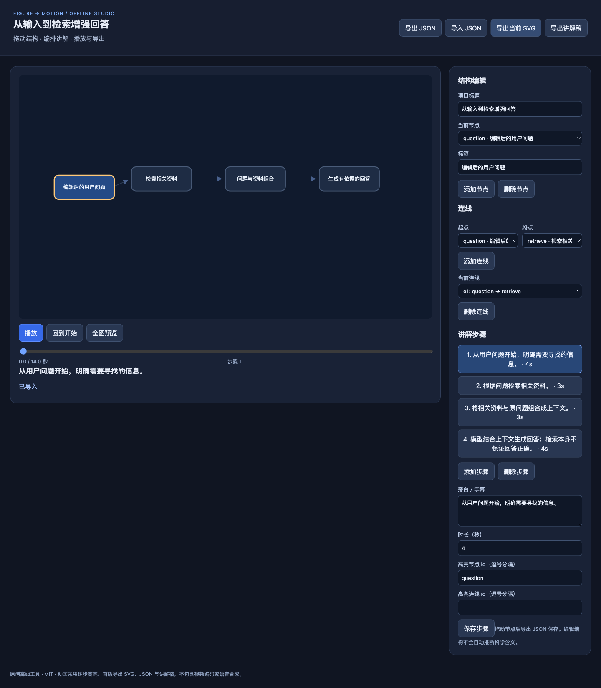

# 图解动画工作台 · figure-motion

[在线合成示例](https://Falix23.github.io/figure-motion-skill/) · [Skill 工作流](SKILL.md)

将清晰的论文架构图、技术流程图或结构化说明转为可编辑节点、连线和分步讲解动画，输出离线 HTML、JSON、SVG 与讲解稿。

## 运行示例

需要 Python 3.10+ 与现代浏览器，无第三方运行依赖，无 API 密钥。

```bash
git clone https://github.com/Falix23/figure-motion-skill.git
cd figure-motion-skill
python3 scripts/build.py examples/input.json --output outputs/demo.html
python3 -m http.server 8000 --bind 127.0.0.1
```

打开 http://127.0.0.1:8000/outputs/demo.html 。生成 HTML 也可直接在浏览器打开，资源全部内嵌。页面编辑后须导出 JSON；修改不会自动写回磁盘。

## 安装为 Codex Skill

将完整仓库复制为技能目录，保留 scripts/assets/references：

```bash
mkdir -p ~/.codex/skills/figure-motion
cp -R SKILL.md agents scripts assets references examples ~/.codex/skills/figure-motion/
```

示例请求：

> 使用 $figure-motion，把这张技术流程图做成四步可编辑讲解动画，保留原图标签和箭头方向。

Agent 根据素材生成 [项目 JSON](references/schema.md)，运行构建器并核对实际页面；页面本身不调用 Agent 或视觉模型。每个仓库独立运行，不依赖同批的其他项目。

## 已实现

拖动与编辑节点、添加和删除连线、编辑讲解步骤与高亮对象、播放／暂停／时间轴、全图预览、JSON 导入导出、当前 SVG 和时间区间讲解稿导出。

## 首版边界

首版只还原显式节点和直线箭头，节点固定尺寸；复杂公式、曲线连线、嵌套分组、图片内嵌、视频编码和语音合成未实现。Agent 负责识图和内容核对，HTML 自身没有视觉模型。

示例为原创合成内容。不要将私人素材和实际业务数据提交到公开仓库。所有用户文字通过 DOM 文本节点呈现，内嵌 JSON 对 `<` 转义；浏览器导入仍会校验领域引用与数值范围。

## 验证

```bash
python3 -m unittest discover -s tests -v
python3 scripts/build.py examples/input.json --output outputs/demo.html
```

CI 在 Python 3.12 上执行领域不变量测试与示例构建。MIT 许可，见 [LICENSE](LICENSE)。本项目代码与界面为原创实现，未复制上游项目代码。



